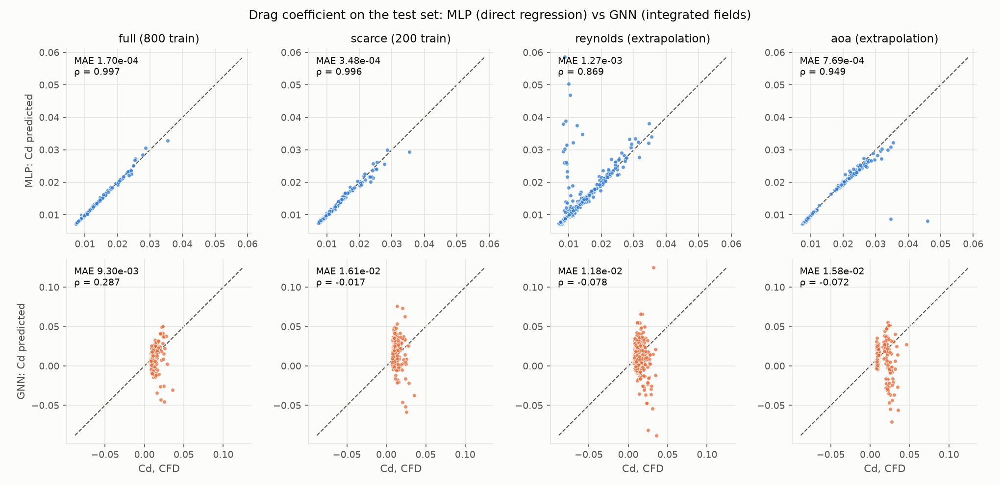
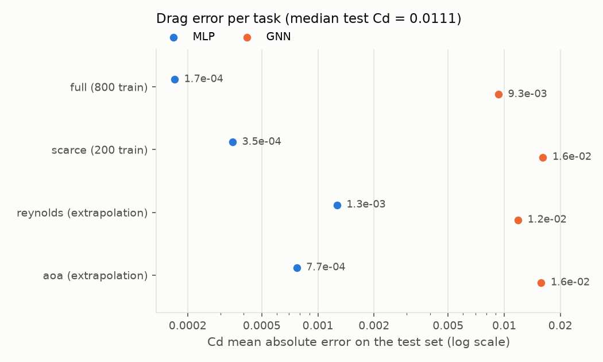
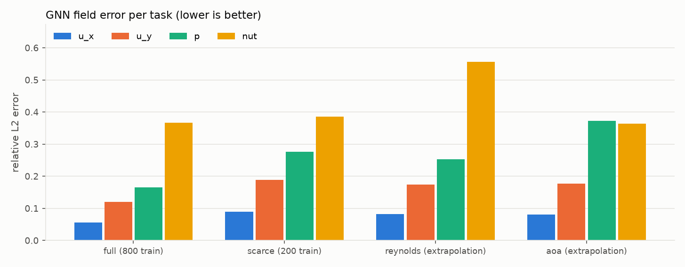
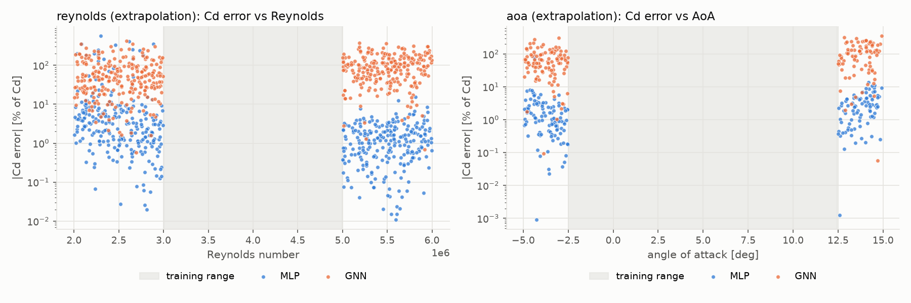

# Results

Test-set metrics. **MLP**: (U, AoA, airfoil shape) → (Cd, Cl) directly. **GNN**: predicts the (u, p, ν_t) fields; Cd/Cl obtained by integrating predicted surface pressure and wall shear.

## Drag and lift

|  | CD MAE | CD RMSE | CD Spearman | CL MAE | CL RMSE | CL Spearman | CD mean rel err [%] |
|---|---|---|---|---|---|---|---|
| full / MLP | 1.70e-04 | 3.74e-04 | 0.997 | 4.10e-03 | 7.29e-03 | 1 | 1.1 |
| full / GNN | 9.30e-03 | 0.0144 | 0.287 | 0.0493 | 0.0658 | 0.993 | 67.5 |
| scarce / MLP | 3.48e-04 | 7.04e-04 | 0.996 | 0.0112 | 0.0153 | 1 | 2.25 |
| scarce / GNN | 0.0161 | 0.0211 | -0.0166 | 0.0715 | 0.0932 | 0.987 | 129 |
| reynolds / MLP | 1.27e-03 | 4.88e-03 | 0.869 | 0.0154 | 0.0404 | 0.997 | 11.8 |
| reynolds / GNN | 0.0118 | 0.0184 | -0.0779 | 0.0875 | 0.108 | 0.985 | 86.7 |
| aoa / MLP | 7.69e-04 | 3.37e-03 | 0.949 | 6.89e-03 | 9.85e-03 | 1 | 3.15 |
| aoa / GNN | 0.0158 | 0.0242 | -0.0721 | 0.0833 | 0.106 | 0.963 | 89.1 |

## GNN field accuracy (relative L2 error)

| task | relL2_u_x | relL2_u_y | relL2_p | relL2_nut |
|---|---|---|---|---|
| full | 0.0558 | 0.12 | 0.166 | 0.367 |
| scarce | 0.0903 | 0.188 | 0.276 | 0.385 |
| reynolds | 0.082 | 0.174 | 0.253 | 0.557 |
| aoa | 0.0804 | 0.177 | 0.373 | 0.364 |

## Where the GNN drag error comes from

| task | pressure part MAE | viscous part MAE | true pressure part (mean) | true viscous part (mean) |
|---|---|---|---|---|
| full | 9.27e-03 | 1.03e-03 | 5.60e-03 | 7.08e-03 |
| scarce | 0.0127 | 8.93e-03 | 5.60e-03 | 7.08e-03 |
| reynolds | 0.0119 | 1.70e-03 | 5.70e-03 | 7.11e-03 |
| aoa | 0.0159 | 9.06e-04 | 9.09e-03 | 6.67e-03 |

## Extrapolation tasks

